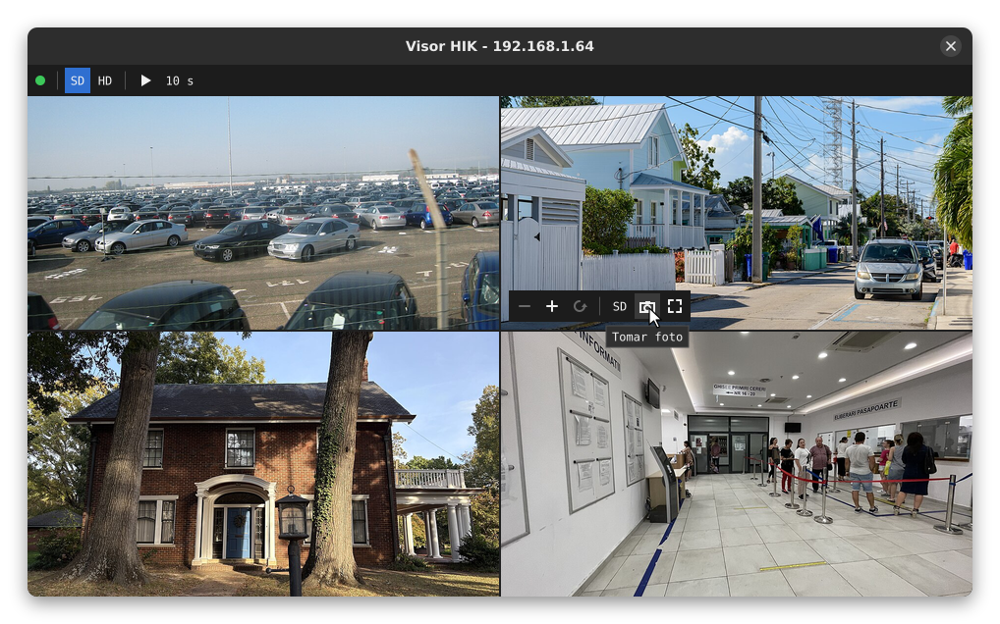

# Visor HIK

Visor en vivo para DVR, NVR y cámaras **Hikvision** en Linux, compatible con la **clave de cifrado de Hik-Connect** (encriptación de stream / código de verificación).

[English version](README.en.md)

## ¿Por qué existe?

Si activas la encriptación de stream en un equipo Hikvision, en Linux prácticamente no hay forma de ver las cámaras:

- La **web del DVR** no permite ingresar la clave de cifrado.
- **RTSP** con ffmpeg/VLC muestra la imagen gris porque los cuadros completos llegan cifrados.
- **iVMS-4200** ya no tiene versión para Linux.

Este visor usa el SDK oficial de Hikvision (HCNetSDK + PlayCtrl), que sí descifra el video con la clave.

## Funciones

- Configuración inicial con formulario: IP, puerto, usuario, contraseña y clave de cifrado (opcional), con botón para probar la conexión.
- Detección automática de cámaras (canales analógicos e IP en línea).
- Mosaico con todas las cámaras usando el substream.
- **Doble clic** en una cámara para verla en grande con el stream principal; doble clic o `Esc` para regresar.
- **Zoom digital** con la rueda del mouse, centrado en el cursor; el nivel de zoom se muestra un momento en la esquina de la cámara.
- Arrastrar con clic izquierdo para moverse con zoom; clic central restablece el zoom.
- **Controles que aparecen al mover el mouse** y se ocultan solos, con tooltip en cada botón:
  - Barra general arriba: estado de la conexión, calidad del mosaico (SD/HD), anterior/siguiente en vista en grande y recorrido automático.
  - Barra en cada cámara: zoom, calidad SD/HD de esa cámara, foto y vista en grande.
- **Recorrido automático**: muestra las cámaras en grande una por una cada 5, 10, 30 o 60 segundos.
- **Fotos** en JPG del cuadro que se está viendo, guardadas en `~/Imágenes/visor-hik/`.
- **Reconexión automática** si se cae la red o el equipo se reinicia; las cámaras sin video muestran "Sin señal" o "Reconectando...".
- La contraseña y la clave de cifrado se guardan en el **llavero del sistema** (GNOME Keyring, KWallet).



## Requisitos

- Linux de 64 bits (x86_64)
- Sesión X11, o Wayland con XWayland (el programa fuerza el uso de X11)
- `g++`, `make`, `pkg-config`, GTK 3 y Xlib

Ubuntu / Debian / Mint:

```bash
sudo apt install build-essential pkg-config libgtk-3-dev libx11-dev
```

Fedora:

```bash
sudo dnf install gcc-c++ make pkgconf-pkg-config gtk3-devel libX11-devel
```

## Instalación

### 1. Descarga el SDK de Hikvision

El SDK **no se incluye** en este repositorio porque tiene su propia licencia. Descárgalo desde la página oficial:

**Hikvision → Soporte → Descargas → SDK → SDK de la red de dispositivos (para Linux de 64 bits)**

https://www.hikvision.com/mx/support/download/sdk/device-network-sdk--for-linux-64-bit-/

### 2. Clona el repositorio y coloca el SDK

```bash
git clone https://github.com/TU_USUARIO/visor-hikvision-linux.git
cd visor-hikvision-linux
unzip ~/Descargas/EN-HCNetSDK*_linux64.zip -d /tmp/hiksdk
mkdir sdk
cp -r /tmp/hiksdk/*/incEn /tmp/hiksdk/*/lib sdk/
```

Debe quedar así:

```
visor-hikvision-linux/
├── sdk/
│   ├── incEn/HCNetSDK.h
│   └── lib/libhcnetsdk.so, libPlayCtrl.so, HCNetSDKCom/ ...
├── src/
└── Makefile
```

Si tienes el SDK en otra carpeta, indícalo al compilar: `make SDK=/ruta/al/sdk`.

### 3. Compila y ejecuta

```bash
make
./visor-hik
```

La primera vez se abre el formulario de conexión. Usa **Probar conexión** para verificar los datos antes de guardar.

### 4. Agrégalo al menú de aplicaciones (opcional)

```bash
make instalar      # lanzador e ícono en ~/.local/share
make desinstalar   # los quita
```

El ícono está en `icono/visor-hik.svg`; puedes reemplazarlo por otro SVG con el mismo nombre y volver a correr `make instalar`. El lanzador apunta a esta carpeta, así que no la muevas después de instalar.

## Uso

```bash
./visor-hik            # abre con la configuración guardada
./visor-hik --config   # vuelve a mostrar el formulario
./visor-hik --debug    # muestra en la terminal la información del equipo y sus canales
```

| Acción | Resultado |
|---|---|
| Doble clic | Cámara en grande / regresar al mosaico |
| `Esc` | Regresar al mosaico |
| Rueda del mouse | Zoom de 1× a 8× |
| Clic izquierdo y arrastrar | Mover la imagen con zoom |
| Clic central | Restablecer zoom |
| Mover el mouse | Mostrar los controles |

| Botón | Dónde | Qué hace |
|---|---|---|
| ● | Barra general | Estado: verde conectado, amarillo reconectando, rojo sin conexión |
| SD / HD | Barra general | Calidad de todo el mosaico |
| ◀ / ▶ | Barra general | Cámara anterior / siguiente en vista en grande |
| ▶ / ❚❚ y tiempo | Barra general | Iniciar o detener el recorrido; el tiempo cambia entre 5, 10, 30 y 60 s |
| − / + / ↺ | Barra de la cámara | Alejar, acercar y restablecer el zoom |
| SD / HD | Barra de la cámara | Calidad de esa cámara |
| Cámara | Barra de la cámara | Tomar foto |
| Esquinas / cuadrícula | Barra de la cámara | Ver en grande / regresar al mosaico |

Las fotos se toman del video decodificado: en el mosaico tienen la resolución del substream; para fotos con más detalle, tómalas en vista en grande o con la cámara en HD.

La configuración se guarda en `~/.config/visor-hik/config.ini` con permisos `600`. La contraseña y la clave de cifrado van al llavero del sistema (Secret Service: GNOME Keyring, KWallet) usando `libsecret`, que se carga al ejecutar y no hace falta para compilar. Si el llavero no está disponible, se guardan en ese archivo en texto plano y el programa lo avisa en la terminal. Una configuración anterior con la contraseña en el archivo se pasa al llavero automáticamente al abrir el visor.

## Configuración del equipo

- El visor se conecta por el **puerto del SDK** (8000 por defecto), no por HTTP ni RTSP.
- La **clave de cifrado** es el código de verificación configurado en *Red → Avanzado → Acceso a plataforma (Hik-Connect)*. Si no usas encriptación, deja el campo vacío.
- Para mejor rendimiento en el mosaico, verifica que las cámaras tengan el **substream** habilitado. Si no lo tienen, el visor usa el stream principal.

## Solución de problemas

**Error "Usuario o contraseña incorrectos" o "No se pudo conectar"**
Revisa la IP y que el puerto 8000 esté habilitado en el equipo.

**La imagen se ve gris o con bloques**
La clave de cifrado no coincide con la del equipo.

**No aparece ninguna cámara**
Ejecuta `./visor-hik --debug` y revisa qué canales reporta el equipo. Puedes indicar los canales a mano en el formulario (`--config`), por ejemplo `1,2,3,4` o `33,34` para cámaras IP en un NVR.

**El mensaje "PlayM4_WndResolutionChange no disponible"**
Tu versión de PlayCtrl no tiene esa función. El zoom funciona, pero tarda un poco más porque reinicia el video de esa cámara.

**La ventana se congela unos segundos de vez en cuando**
Pasa si una cámara está desconectada: el visor reintenta abrirla cada 10 segundos y el SDK espera la respuesta del equipo. Si la cámara ya no existe, quítala de la lista de canales con `--config`.

**¿Por qué no se usa el `plaympeg4.h` del SDK?**
El header que viene en `incEn` es la versión de Windows y no compila en Linux. Las funciones necesarias se declaran en `src/playm4.h` y se enlazan contra `libPlayCtrl.so`, que sí es de Linux.

## Modelos probados

| Modelo | Tipo | Firmware | Estado |
|---|---|---|---|
| DVR-204G-F1 | DVR | V4.30.120 | Funciona |

Si lo pruebas con otro equipo, abre un *issue* con el modelo, el firmware y la salida de `./visor-hik --debug` para agregarlo a la lista.

## Licencia

El código de este repositorio está bajo licencia [MIT](LICENSE). El SDK de Hikvision no se incluye y se rige por sus propios términos.

Este proyecto no está afiliado ni respaldado por Hikvision. Hikvision y Hik-Connect son marcas registradas de Hangzhou Hikvision Digital Technology Co., Ltd.

Las fotos de la captura son de dominio público (CC0); ver [docs/CREDITOS.md](docs/CREDITOS.md).
